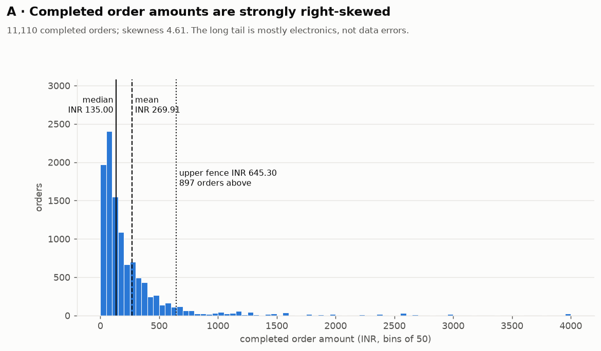
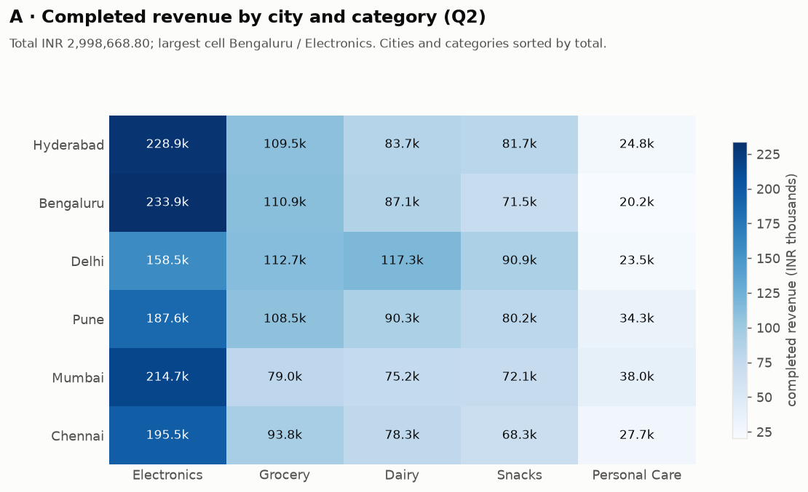
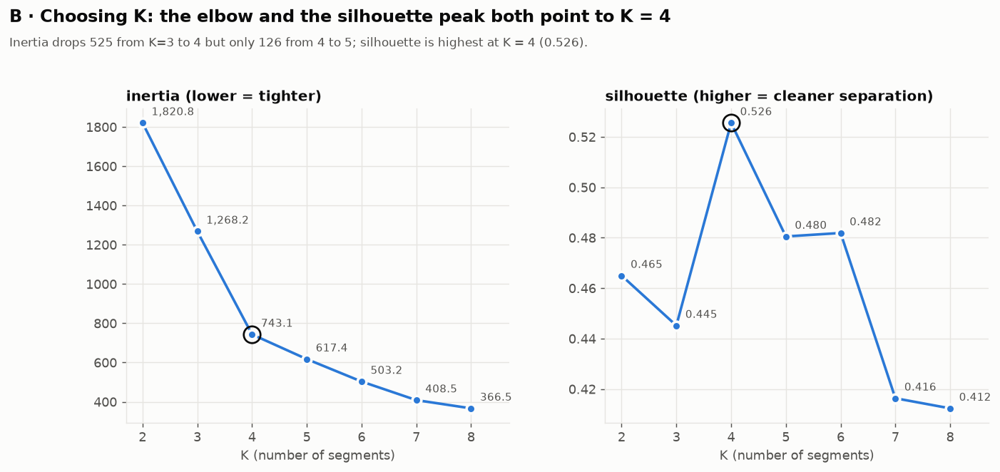
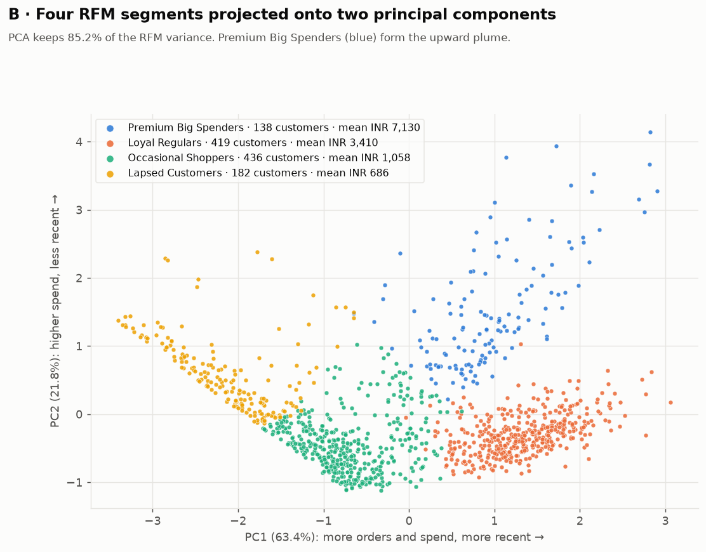
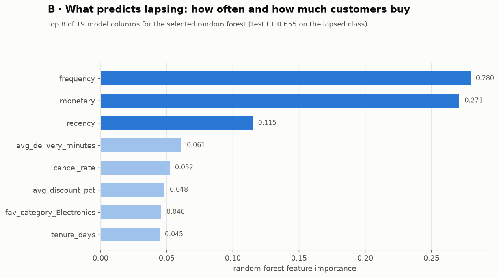
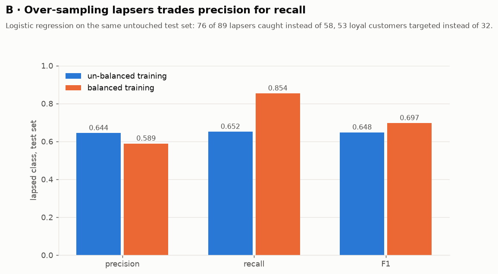
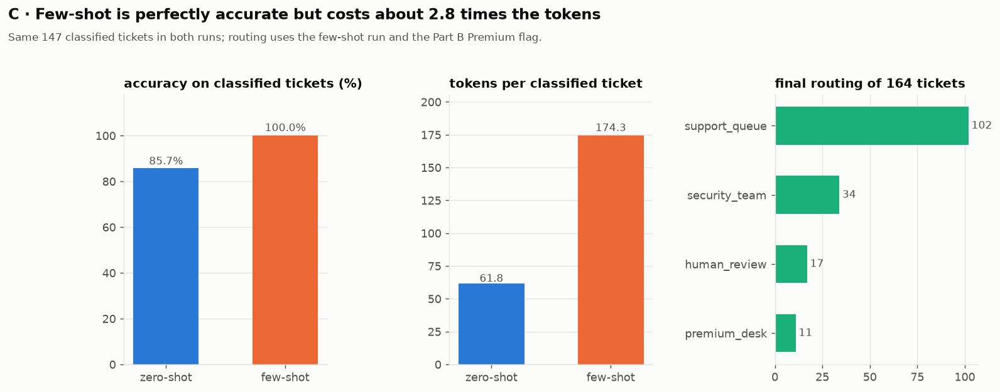
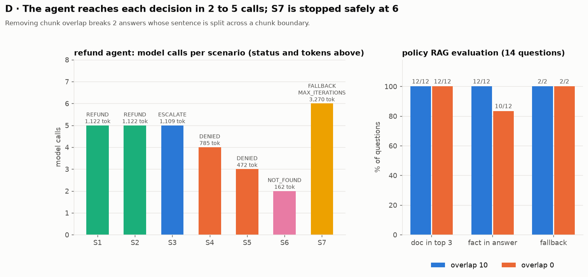

# Instamart Customer Intelligence & Support Copilot

## Overview

An internal Customer Intelligence & Support Copilot for a quick-commerce grocery service, built on fully synthetic data (the brand name only frames the scenario; nothing here is real Instamart data, policy or pricing). All amounts are in INR. The four parts form one pipeline, each consuming what the previous part produced:

| Part | What it does | Consumes | Produces |
|---|---|---|---|
| A | Audits and cleans the dirty raw exports, stores them in SQLite, answers business questions in SQL and pandas | `data/raw/*.csv` | `data/clean/*.csv`, `data/instamart.db`, `sql/queries.sql` |
| B | Segments customers with RFM + K-means and predicts who will lapse, without leakage | Part A clean CSVs | `outputs/customer_segments.csv`, `outputs/lapse_model.joblib`, `outputs/retention_list.csv` |
| C | Triages support tickets: input guardrails, PII redaction, retries, output validation, token budget, routing by segment | tickets + Part B segments | `outputs/triage_results.csv`, `outputs/triage_budget_demo.csv` |
| D | Answers policy questions with retrieval-grounded generation (plain Python and LangChain) and decides refunds with a ReAct agent that queries the Part A database | policies + Part A database | `outputs/agent_runs.jsonl`, `outputs/refund_ledger.jsonl`, `state/` |

Every language-model call goes through the supplied offline `mock_llm.py`: no API key, no network and no cost. `generate_data.py` and `mock_llm.py` are used unmodified.

**Technologies.** Python 3.11+ with pandas, NumPy, scikit-learn and joblib for the graded pipeline (Parts A–D), and SQLite through the standard-library `sqlite3`. As required by the programme guidelines, the project also uses **LangChain** (`langchain-core`: the Part D RAG chain in `part_d/rag_langchain.py`, verified to give identical answers to the plain pipeline), **React** (a no-build front end in `frontend/`, served by the standard-library server `part_d/server.py`; React 18.3.1 is shipped in `frontend/vendor/` so it works offline) and **matplotlib** (charts generated by `viz/make_figures.py` into `outputs/figures/`). Every finding is also stated in numbers and words in this README.

**Repository layout.** `data/` (raw, clean, policies, database) · `part_a/` `part_b/` `part_c/` `part_d/` (code per part) · `sql/` (schema and queries) · `outputs/` (results, model, figures) · `state/` (agent checkpoints) · `frontend/` (React page) · `viz/` (figure script).

## Reproduce

```bash
1. python -m venv .venv
2. .venv\Scripts\activate            # macOS/Linux: source .venv/bin/activate
   # Windows PowerShell: if scripts are blocked, first run
   #   Set-ExecutionPolicy -Scope Process -ExecutionPolicy Bypass
3. pip install -r requirements.txt
4. python generate_data.py           # expect: generated: customers=1200 products=40 orders_raw=13084 tickets=164
5. python part_a/audit.py            # raw-data audit; expect: AUDIT MATCHES REFERENCE
6. python part_a/clean.py            # writes data/clean/customers.csv, products.csv, orders.csv
7. python part_a/store.py            # builds data/instamart.db from sql/schema.sql
8. python part_a/validate.py         # expect: ALL CHECKPOINTS PASSED
9. python part_a/sql_analysis.py     # runs sql/queries.sql Q1-Q7; expect: ALL QUERIES MATCH REFERENCE
10. python part_a/eda.py             # pandas cross-check + statistics; expect: EDA MATCHES REFERENCE
11. python part_b/segments.py        # RFM, K-means (K = 4), PCA; writes outputs/customer_segments.csv
12. python part_b/lapse_model.py     # lapse model; writes outputs/lapse_model.joblib, outputs/retention_list.csv
13. python part_c/triage.py          # ticket triage; writes outputs/triage_results.csv, outputs/triage_budget_demo.csv
14. python part_d/rag.py             # policy RAG: chunking, retrieval, evaluation (overlap 10 and 0)
15. python part_d/rag_langchain.py   # same RAG as a LangChain chain; expect: LANGCHAIN CHAIN MATCHES PLAIN PIPELINE
16. python part_d/agent.py           # refund agent; writes outputs/agent_runs.jsonl, outputs/refund_ledger.jsonl, state/
17. python viz/make_figures.py       # charts for Parts A-D into outputs/figures/
```

Every script ends with a line confirming it matched the brief's reference values (for example `ALL CHECKPOINTS PASSED`, `PART C COMPLETE`, `PART D AGENT MATCHES REFERENCE`) and stops with an error if any check fails. Steps 13 and 16 take a few seconds each (retry back-off and grid search are deliberate).

**Optional: the React front end (Part D).** After step 16, run `python part_d/server.py` and open http://127.0.0.1:8000 to ask policy questions and run refund scenarios in the browser. Runs started from the page write to `outputs/ui_refund_ledger.jsonl` and `state/ui/` (both git-ignored), so the committed outputs are never changed.

## Part A

Part A turns the dirty raw exports into a trusted SQLite database. Scripts live in `part_a/`, SQL in `sql/`, and each script checks its own output against the brief's reference values. All amounts are in INR.

| Step | Script | Output |
|---|---|---|
| Audit the raw data | `part_a/audit.py` | audit tables (below) |
| Clean customers and orders | `part_a/clean.py` | `data/clean/customers.csv`, `products.csv`, `orders.csv` |
| Store | `part_a/store.py` + `sql/schema.sql` | `data/instamart.db` (tables `customers`, `products`, `orders`) |
| Validate | `part_a/validate.py` | prints `ALL CHECKPOINTS PASSED` (15 checks) |
| SQL analysis | `sql/queries.sql` run by `part_a/sql_analysis.py` | Q1–Q7 results (below) |
| pandas cross-check and EDA | `part_a/eda.py` | statistics (below) |

### A2. Raw data audit

Reading rule: only an empty cell counts as missing (`keep_default_na=False, na_values=[""]`). With pandas' default, the text `N/A` in `order_amount` is silently read as missing, which hides 53 of the 120 unparseable amounts.

**orders.csv** — 13,084 rows × 9 columns

| column | dtype | missing | missing % |
|---|---|---:|---:|
| order_id | str | 0 | 0.00% |
| customer_id | str | 0 | 0.00% |
| product_id | str | 0 | 0.00% |
| quantity | int64 | 0 | 0.00% |
| order_ts | str | 0 | 0.00% |
| status | str | 0 | 0.00% |
| discount_pct | int64 | 0 | 0.00% |
| order_amount | str | 0 | 0.00% |
| delivery_minutes | float64 | 2,541 | 19.42% |

`order_amount` is read as text because it contains non-numeric entries.

**customers.csv** — 1,200 rows × 5 columns

| column | dtype | missing | missing % |
|---|---|---:|---:|
| customer_id | str | 0 | 0.00% |
| city | str | 0 | 0.00% |
| signup_date | str | 0 | 0.00% |
| age | float64 | 61 | 5.08% |
| gender | str | 30 | 2.50% |

**products.csv** — 40 rows × 4 columns, no missing values (product_id, product_name, category: str; price_inr: int64).

**Audit figures** (all match the reference)

| check | value |
|---|---:|
| orders.csv rows | 13,084 |
| exact duplicate rows | 119 |
| rows with status = pending | 656 |
| distinct order_id | 12,309 |
| non-numeric order_amount (67 `error`, 53 `N/A`) | 120 |
| negative delivery_minutes | 106 |
| blank delivery_minutes | 2,541 |
| blank age | 61 |
| age outside 10–100 | 6 |
| distinct raw city spellings | 24 |
| distinct non-blank gender spellings | 10 |
| blank gender | 30 |

### A3. Cleaning rules — customers

| rule | values changed |
|---|---:|
| (a) city: strip spaces and title case (24 spellings such as `pune`, `PUNE`, ` Pune ` → 6 cities). Done first, because rule (c) groups by city. | 476 |
| (b) gender: `male/Male/M/m/MALE` → male, `female/Female/F/f/FEMALE` → female, blank → unknown | 950 (incl. 30 blanks) |
| (c) age outside 10–100 set to missing | 6 |
| (c) missing age filled with the median age of the customer's city (`groupby` + `transform`) | 67 (61 blank + 6 impossible) |
| (d) `signup_date` converted to datetime | 1,200 |

City medians used: Bengaluru 42.0, Chennai 39.0, Delhi 43.0, Hyderabad 37.5, Mumbai 38.5, Pune 39.0. Ages filled from Hyderabad and Mumbai are therefore fractional (21 customers); they are kept as computed rather than rounded, following the brief literally.

Result: Pune 227, Delhi 210, Bengaluru 197, Chennai 191, Hyderabad 191, Mumbai 184; female 610, male 560, unknown 30; 0 missing ages, every age between 18 and 60.

### A4. Cleaning rules — orders (applied in this order)

| # | rule | rows / values changed |
|---|---|---:|
| 1 | `order_ts` converted to datetime | 13,084 rows |
| 2 | exact duplicate rows removed | 119 rows (13,084 → 12,965) |
| 3 | one row per `order_id`: kept the record with the latest `order_ts` (the earlier `pending` record is superseded by the final status) | 656 rows (12,965 → 12,309) |
| 4 | `order_amount` to numeric; unparseable values rebuilt as round(price_inr × quantity × (1 − discount_pct / 100), 2) | 112 values |
| 5 | negative `delivery_minutes` set to missing | 105 values |
| 5 | missing `delivery_minutes` of completed orders filled with the median of the product category among completed orders | 774 values |
| 5 | cancelled orders: `delivery_minutes` left missing (never delivered, so a time would be invented data) | 1,199 left missing |

The audit found 120 unparseable amounts and 106 negative delivery times, but rules 4 and 5 changed only 112 and 105: the remaining 8 and 1 sat in duplicate or pending records already removed by rules 2–3. Category medians used: Dairy 25.0, Electronics 25.0, Grocery 25.0, Personal Care 25.5, Snacks 25.0 minutes.

Result: 12,309 rows (one per `order_id`); 11,110 completed, 1,199 cancelled, 0 pending; 0 missing `order_amount`; 0 missing `delivery_minutes` among completed and 1,199 among cancelled orders; completed revenue INR 2,998,668.80.

### A5. Store and validate

`sql/schema.sql` defines the three tables with primary keys, foreign keys (`orders.customer_id` → `customers`, `orders.product_id` → `products`) and CHECK constraints (status only `completed`/`cancelled`, non-negative amounts and delivery times), so bad data is rejected at load time. `order_ts` is stored as text `YYYY-MM-DD HH:MM:SS`. `part_a/validate.py` re-reads the saved CSV files and database and asserts 15 checkpoints (customer counts, order counts, missing values, completed revenue in both pandas and SQL, table names, row counts, timestamp format); it prints `ALL CHECKPOINTS PASSED`.

### A6. SQL analysis (`sql/queries.sql`)

Only completed orders count as revenue or spend.

| query | technique | result | reference |
|---|---|---|---|
| Q1 | `WHERE` then `HAVING`: completed orders > INR 500, customer total > INR 8,000 | 30 customers (top: C0693 INR 13,776.55) | 30 |
| Q2 | three-table join: revenue by city × category | 30 rows summing to INR 2,998,668.80; largest Bengaluru / Electronics INR 233,909.45 | same |
| Q3 | scalar subquery: products above the average price (INR 289.32) | 11 products | 11 |
| Q4 | `LEFT JOIN`: customers with no completed order | 25 customers (18 never ordered, 7 had only cancelled orders) | 25 |
| Q5 | two CTEs: customers above the average customer spend | 550 customers; average INR 2,552.06 | same |
| Q6 | `RANK()`, `DENSE_RANK()`, `ROW_NUMBER()` by city | 1,175 rows; 8 rows where RANK() ≠ ROW_NUMBER() | same |
| Q7 | running total `SUM(revenue) OVER (ORDER BY day)` | 183 days; last cumulative INR 2,998,668.80 | same |

In Q4 the status filter sits in the `ON` clause: placed in `WHERE` it removes the unmatched (NULL) rows and returns 0, and without it the query returns only the 18 customers who never ordered.

**Q6 — top customer per city**

| city | customer | total spend (INR) |
|---|---|---:|
| Bengaluru | C0082 | 12,856.20 |
| Chennai | C0930 | 10,151.40 |
| Delhi | C0291 | 13,742.60 |
| Hyderabad | C0743 | 12,730.05 |
| Mumbai | C0693 | 14,766.55 |
| Pune | C0426 | 10,377.10 |

**Q6 — rows where RANK() differs from ROW_NUMBER()**

| city | customer | total spend (INR) | RANK | DENSE_RANK | ROW_NUMBER |
|---|---|---:|---:|---:|---:|
| Bengaluru | C0734 | 2,598.00 | 99 | 99 | 100 |
| Bengaluru | C0723 | 135.00 | 179 | 178 | 180 |
| Mumbai | C1053 | 396.00 | 149 | 149 | 150 |
| Mumbai | C0608 | 280.00 | 160 | 159 | 161 |
| Pune | C1064 | 3,236.95 | 74 | 74 | 75 |
| Pune | C0057 | 285.00 | 189 | 188 | 190 |
| Pune | C0936 | 285.00 | 189 | 188 | 191 |
| Pune | C0276 | 114.00 | 209 | 206 | 210 |

Why they differ: RANK() assigns the same rank (189) to tied spend values, whereas ROW_NUMBER() breaks ties by assigning unique, sequential integers (189, 190, 191) based on row processing order, which is arbitrary among the tied rows, so C0057 and C0936 could just as easily swap places. So in every tie, each row after the first gets a ROW_NUMBER() larger than its RANK(), which produces the 8 rows above.

### A7. pandas cross-check and exploratory analysis

**(a) Cross-check.** `pd.pivot_table(..., margins=True)` over city × category gives a grand total of INR 2,998,668.80, equal to the SQL total of Q2.

| city | sum (INR) | mean (INR) | count |
|---|---:|---:|---:|
| Bengaluru | 523,643.40 | 276.47 | 1,894 |
| Chennai | 463,629.15 | 272.72 | 1,700 |
| Delhi | 502,829.80 | 243.62 | 2,064 |
| Hyderabad | 528,589.90 | 284.95 | 1,855 |
| Mumbai | 479,058.50 | 297.00 | 1,613 |
| Pune | 500,918.05 | 252.48 | 1,984 |

**(b) Completed `order_amount`**

| statistic | value |
|---|---:|
| mean | INR 269.91 |
| median | INR 135.00 |
| skewness | 4.61 |
| Q1 / Q3 | INR 64.80 / INR 297.00 |
| IQR | INR 232.20 |
| lower fence (Q1 − 1.5 IQR) | INR −283.50 (0 outliers below) |
| upper fence (Q3 + 1.5 IQR) | INR 645.30 (897 outliers above) |

Of the 897 high outliers, 635 are Electronics and 166 are Dairy (Ghee bought in 2–3 units).

**Correlation matrix (completed orders)**

| | order_amount | discount_pct | quantity | delivery_minutes |
|---|---:|---:|---:|---:|
| order_amount | 1.000 | −0.095 | 0.087 | −0.003 |
| discount_pct | −0.095 | 1.000 | 0.000 | −0.010 |
| quantity | 0.087 | 0.000 | 1.000 | −0.013 |
| delivery_minutes | −0.003 | −0.010 | −0.013 | 1.000 |

**Findings**

*What is this data about?* This dataset covers 11,110 synthetic Instamart quick-commerce completed orders across six cities and five product categories from 1 April to 30 September 2025, with amounts recorded in INR.

*What do its distributions and statistics look like?* The order values are strongly right-skewed, carrying a high skewness of 4.61. This explains why the mean of INR 269.91 is twice the median of INR 135.00: a long tail of high-value transactions pulls the average up while half of all orders remain at or below INR 135.00.

*Are there outliers or anomalies?* Upper outliers account for 897 orders exceeding INR 645.30. These are legitimate purchases rather than data errors, driven primarily by higher-priced electronics alongside multi-unit buys of pricier essentials like Ghee (2–3 units). There are no lower outliers.

*What relationships exist between variables?* Relationships among variables are minimal. The strongest correlation pair is order amount with discount at −0.095; order amount with quantity is +0.087, slightly weaker. Delivery time shows virtually zero correlation with any variable. A correlation this small doesn't show that one causes the other.

### A8. Figures





## Part B

Part B segments customers and predicts who is likely to lapse. It reads `data/clean/orders.csv` and `data/clean/customers.csv` from Part A; only completed orders count. Scripts live in `part_b/`.

### B1. RFM table (`part_b/segments.py`)

Snapshot moment 2025-10-01 00:00:00. Recency = whole days since the customer's last completed order; frequency = distinct completed orders; monetary = total completed spend (INR).

| measure | value |
|---|---:|
| customers with at least one completed order | 1,175 |
| recency median / min / max (days) | 19 / 0 / 180 |
| frequency mean / max | 9.46 / 33 |
| monetary mean / max (INR) | 2,552.06 / 14,766.55 |

### B2. K-means on standardised RFM

The three RFM columns are standardised with `StandardScaler`, then `KMeans(n_clusters=K, n_init=10, random_state=42)` is fitted for K = 2 to 8.

| K | inertia | silhouette |
|---:|---:|---:|
| 2 | 1,820.8 | 0.465 |
| 3 | 1,268.2 | 0.445 |
| **4** | **743.1** | **0.526** |
| 5 | 617.4 | 0.480 |
| 6 | 503.2 | 0.482 |
| 7 | 408.5 | 0.416 |
| 8 | 366.5 | 0.412 |

**Why inertia alone cannot pick K.** Inertia is the total squared distance of customers to their segment centre, and adding a segment can only move customers closer to a centre, so inertia always falls as K rises: K = 8 is always below K = 2, and at K = 1,175 every customer would be their own segment with an inertia of 0. A metric that always rewards more splitting cannot say when to stop, so K is chosen from where the improvement levels off (the elbow), the silhouette score and whether the business can act on the segments.

**Model selection: K = 4.** We select K = 4 for the final customer segmentation based on both mathematical indicators and business interpretability:

- **Elbow method:** inertia drops significantly from 1,268.2 at K = 3 to 743.1 at K = 4 (a reduction of 525.1), after which returns diminish sharply (4 to 5 drops by only 125.7).
- **Silhouette analysis:** the silhouette score reaches its peak at K = 4 (0.526), indicating the most compact and clearly separated clusters among K = 2 to 8.
- **Business segmentation:** K = 4 is the smallest cluster count that isolates high-value customers (mean spend about INR 7,130) from frequent grocery shoppers. K = 3 merges these two distinct behavioural profiles into one segment, while K = 5 only splits the low-activity customers into "fading" (about 70 days since last order) and "gone" (about 133 days), adding little actionable value at a lower silhouette (0.480).

### B3. Segment profiles, names and actions (K = 4)

Cluster numbers are only labels produced by K-means; they carry no order or ranking. Segments are named from their profile. The segment with the highest mean monetary value is marked Premium.

| segment_id | segment name | size | mean recency (days) | mean frequency | mean monetary (INR) | premium | recommended action |
|---:|---|---:|---:|---:|---:|---|---|
| 1 | Premium Big Spenders | 138 | 24.1 | 6.8 | 7,129.7 | yes | VIP treatment: early access to electronics launches and priority (premium desk) support |
| 2 | Loyal Regulars | 419 | 8.8 | 19.4 | 3,410.0 | no | Reward the habit: loyalty points or a subscription on staples, plus basket-building offers |
| 0 | Occasional Shoppers | 436 | 28.9 | 3.8 | 1,057.6 | no | Build frequency: free delivery on the next three orders and timely restock reminders |
| 3 | Lapsed Customers | 182 | 109.0 | 2.2 | 686.0 | no | Win back: a time-limited comeback coupon and a short "what went wrong" survey |

**PCA.** `PCA(n_components=2)` on the scaled RFM matrix gives `explained_variance_ratio_` = 0.634 and 0.218 (total 0.852), so two components keep 85.2% of the RFM variance. The first component rises with frequency and monetary and falls with recency (overall engagement); the second rises with monetary and recency (high spend but less recent).

Output: `outputs/customer_segments.csv` with columns customer_id, recency, frequency, monetary, segment_id, segment_name, is_premium (1,175 rows, 138 premium).

### B4. Lapse problem (`part_b/lapse_model.py`)

Cutoff 2025-09-01. The cohort is every customer with at least one completed order before the cutoff; `lapsed` = 1 if the customer has no completed order from 2025-09-01 to 2025-09-30.

Features, built only from orders dated before the cutoff plus the clean customer table: recency (days from the cutoff to the last completed order), frequency, monetary, average discount_pct of completed orders, cancellation rate (cancelled ÷ all final-status orders before the cutoff), average delivery_minutes of completed orders, favourite product category (most frequent among completed orders, ties broken alphabetically), city, age, gender and tenure in days (cutoff minus signup_date).

**Leakage controls**

- No order dated 2025-09-01 or later enters any feature; the script asserts that the latest feature row is before the cutoff.
- The segment labels from B3 are not used as features. They come from whole-window RFM that includes September: the "Lapsed Customers" segment has a 100% lapse rate in the cohort, so using it would hand the model the answer.
- No encoder, scaler or resampler saw a test row: preprocessing sits inside a scikit-learn `Pipeline` fitted on training rows only (and refitted on each cross-validation fold), and over-sampling (B7) touches training rows only.

| item | value | reference |
|---|---:|---:|
| cohort | 1,156 customers | 1,156 |
| lapsed | 443 (38.32%) | 443 (38.32%) |
| train / test rows (`train_test_split(test_size=0.2, stratify=y, random_state=42)`) | 924 / 232 | 924 / 232 |
| baseline "always not lapsed" on test: accuracy / lapsed-class F1 | 61.6% / 0.00 | 61.6% / 0 |

### B5. Preprocessing without leakage

`ColumnTransformer` with `StandardScaler` on the 8 numeric features and `OneHotEncoder(drop="first")` (k−1 columns per variable) on city, gender and favourite category, giving 19 model columns (8 numeric + 11 one-hot). The code confirms no feature column contains a missing value, before or after preprocessing.

| frequency mean | value |
|---|---:|
| learned by the fitted scaler (training rows) | 8.1147 |
| full cohort | 8.0285 |

The scaler's mean learned from the training rows (8.1147) differs from the full-cohort mean (8.0285) because it was fitted on the 924 training customers only, so the difference is evidence that no feature distribution from the 232 unseen test rows leaked into preprocessing.

### B6. Train, tune and evaluate

Both searches use 5-fold cross-validation on the training rows with `scoring="f1"` (lapsed = positive class). The test set was used once, after tuning finished.

| model | grid | best parameters | best CV F1 |
|---|---|---|---:|
| `LogisticRegression(max_iter=1000)` | C ∈ {0.01, 0.1, 1, 10, 100} (25 fits) | C = 100 | 0.651 |
| `RandomForestClassifier(n_estimators=100, random_state=42)` | max_depth ∈ {3, 5, 8} × min_samples_leaf ∈ {5, 10, 20} (45 fits) | max_depth = 8, min_samples_leaf = 10 | 0.681 |

The logistic-regression grid is a statistical tie: mean CV F1 is 0.646 / 0.645 / 0.649 / 0.651 for C = 0.1 / 1 / 10 / 100 with a fold-to-fold standard deviation of about 0.03, so the winner is decided by noise. The reference reports C = 1; our favourite-category feature uses completed orders only (the brief's rule for customer behaviour), which tips the tie to C = 100. Computing it over all orders instead reproduces C = 1 (test F1 0.640).

**Test set (lapsed = positive class)**

| model | TN | FP | FN | TP | precision | recall | F1 |
|---|---:|---:|---:|---:|---:|---:|---:|
| baseline (always "not lapsed") | 143 | 0 | 89 | 0 | 0.000 | 0.000 | 0.000 |
| logistic regression (C = 100) | 111 | 32 | 31 | 58 | 0.644 | 0.652 | 0.648 |
| **random forest (depth 8, leaf 10)** | 113 | 30 | 31 | 58 | 0.659 | 0.652 | **0.655** |

**Model choice: random forest.** Between logistic regression and random forest, the random forest is the better choice for this retention campaign. While both models perform identically on actual lapsed customers—catching the exact same 58 True Positives and missing 31 False Negatives—the random forest achieves slightly fewer false positives (30 versus 32). In a quick-commerce context, missing a lapsing customer (False Negative) risks losing high-value customer lifetime value, making strong recall crucial, while avoiding wasted promotional budget on loyal users. Although logistic regression offers simpler coefficients for stakeholder explanations, the random forest's slightly higher precision and F1 score (0.655 versus 0.648) and its clearer lead in cross-validation (F1 0.681 versus 0.651) suggest this edge is not just luck of the test split, making it the more robust operational tool.

### B7. Class-balance experiment

Training rows only: every original row is kept and 216 lapsed rows are duplicated (sampled with replacement, `random_state=42`) until both classes have 570 rows. The best logistic regression is refitted on the balanced data and evaluated on the original, unchanged test set.

| logistic regression | precision | recall | F1 | customers flagged | lapsers caught | loyal customers targeted |
|---|---:|---:|---:|---:|---:|---:|
| un-balanced training | 0.644 | 0.652 | 0.648 | 90 | 58 | 32 |
| balanced training | 0.589 | 0.854 | 0.697 | 129 | 76 | 53 |

Re-balancing the training set shifted the model's focus toward catching churners: recall jumped significantly from 0.652 to 0.854 (a ~20-percentage-point increase), while precision dropped slightly from 0.644 to 0.589. For the retention team, this trade-off means contacting a larger pool of customers and sending coupons to 53 loyal customers instead of 32, but catching 76 of the 89 lapsers instead of 58 makes this budget cost well worth avoiding the higher long-term cost of lost customer lifetime value.

### B8. Interpret, persist and use

**Random forest: top 5 feature importances** — frequency 0.280, monetary 0.271, recency 0.115, avg_delivery_minutes 0.061, cancel_rate 0.052.

**Logistic regression coefficients** (standardised features; positive = more likely to lapse)

| feature | coefficient | business reading |
|---|---:|---|
| frequency | −1.698 | Customers who order frequently have built a strong ordering habit, so they rarely lapse. |
| recency | +0.040 | Customers who placed their last order longer ago are losing touch, making them slightly more likely to lapse. |
| monetary | +0.285 | Customers who spend more at the same order frequency are occasional high-ticket buyers (for example electronics) rather than habitual daily users, making them more vulnerable to churn. |

**Persistence.** The selected random-forest pipeline (preprocessing + classifier) is saved with `joblib.dump` to `outputs/lapse_model.joblib`; after `joblib.load`, the reloaded model reproduces all 232 test predictions exactly.

**Retention list.** 40 test-set customers are in the Premium segment. Ranked by the model's predicted lapse probability, the top 10 (probabilities 0.452 to 0.491) are written to `outputs/retention_list.csv` (columns customer_id, lapse_probability, actually_lapsed); 1 of the 10 truly lapsed. The Premium flag comes from the whole-window RFM of B3, which includes the September window that defines the lapse label, so it is a post-hoc whole-window label and this retention list is illustrative, not a leakage-free evaluation. (The model's own features use only orders before the cutoff.)

### B9. Figures









## Part C

Part C triages the 164 support tickets in `data/raw/tickets.csv` (read with `keep_default_na=False`) in file order, with `mock_llm.py` as the model. Code: `part_c/triage.py`.

### C1. Input guardrails

Before any model call, a ticket whose text is empty or only whitespace gets status `skipped_empty`, and a ticket with `est_tokens(text) > MAX_INPUT_TOKENS = 400` gets status `flagged_long`. Neither is ever sent to the model.

| guardrail | tickets | detail |
|---|---:|---|
| skipped_empty | 4 | empty text |
| flagged_long | 4 | each estimates to 734 tokens |
| eligible for the model | 156 | |

### C2. PII redaction

Applied in this order (emails first, so digits inside an address are never half-masked by the later patterns): email `[\w.+-]+@[\w-]+\.[\w.]+` → `[EMAIL]`; phone `\b[6-9]\d{9}\b` → `[PHONE]`; order id `ORD-\d{6}` → `[ORDER_ID]`. The user message sent to the model is exactly the redacted text, and an `assert` before every call proves no email, phone or order id is present.

| type | substitutions (all 164 tickets) |
|---|---:|
| email | 55 |
| phone | 91 |
| order id | 132 |
| **total** | **278** |

Re-applying the three patterns to the redacted texts finds 0 matches.

### C3. Prompts

Both prompts contain the word CLASSIFY, list billing, delivery, technical and fraud, and require a JSON-only reply `{"category": "...", "reason": "..."}`.

| prompt | estimated tokens | examples |
|---|---:|---|
| zero-shot | 30 | none (no `EXAMPLES:` line) |
| few-shot | 136 | `EXAMPLES:` + four labelled, already-redacted examples (fraud, technical, delivery, billing), with short reasons to save tokens |

The fraud example deliberately mentions a charge, because fraud tickets share money words with billing tickets.

### C4. Resilient calls

Every call goes through a retry wrapper: at most 3 retries, waiting `BASE_DELAY × 2**n × random.uniform(0.9, 1.15)` with `BASE_DELAY = 0.05` s before retry number n, and logging one line per retry (ticket id, retry number, wait). `mock_llm.reset()` is called before each full run. A full run over the 156 eligible tickets raised **19** `TransientLLMError`s, all recovered on retry number 0 with waits between 0.0453 and 0.0562 s (allowed range 0.045–0.0575 s); no ticket ended with a permanent error.

### C5. Output validation

A reply is accepted as `classified_json` if it is JSON whose category is one of the four. Otherwise, if it is not valid JSON, the lowercase words are extracted with `re.findall(r"[a-z]+", text.lower())` (so `billing-related` yields `billing` and `related`) and the reply is accepted as `classified_keyword` if exactly one category word is present. Everything else, including valid JSON with a category outside the list, is `flagged_invalid_output` and goes to human review; the code never guesses.

| status | tickets |
|---|---:|
| classified_json | 135 |
| classified_keyword | 12 (the mock's chatty "…a billing-related problem." replies) |
| flagged_invalid_output | 9 (JSON with the made-up category "shipping") |

### C6. Zero-shot vs few-shot

Full runs, no token budget; accuracy is measured against `true_category` over the classified tickets.

| prompt | classified | correct | accuracy | total tokens | tokens per classified ticket |
|---|---:|---:|---:|---:|---:|
| zero-shot | 147 | 126 | 85.7% | 9,088 | 61.8 |
| few-shot | 147 | 147 | 100.0% | 25,624 | 174.3 |

**Zero-shot confusion table** (rows = true category, columns = predicted)

| true \ predicted | billing | delivery | fraud | technical |
|---|---:|---:|---:|---:|
| billing | 38 | 0 | 0 | 0 |
| delivery | 0 | 36 | 0 | 0 |
| fraud | 11 | 0 | 23 | 0 |
| technical | 10 | 0 | 0 | 29 |

Every zero-shot error is a fraud or technical ticket predicted as billing. The mock does not read the example content: the `EXAMPLES:` marker makes it check fraud and technical keywords before billing, so with the mock the examples change the token cost but not the accuracy; with a real model their content would matter.

**When the few-shot tokens are worth paying for.** Few-shot prompting is worth the ~2.8x token cost (174.3 vs 61.8 tokens per ticket) because it lifts accuracy from 85.7% to 100% on the 147 classified tickets. Zero-shot misclassifies 21 tickets (11 fraud and 10 technical) as billing, and the 11 fraud tickets drop into the normal support queue with normal priority instead of reaching the security team with high priority. Since fraud tickets require immediate high-priority security intervention, misclassifying them delays critical response, making the token premium a necessary investment for correct routing. Zero-shot would be acceptable if fraud detection were handled by a separate upstream filter or if the token budget were severely constrained.

### C7. Token budget, routing and outputs

Before each model call, if the running total of `usage.total_tokens` is already ≥ `TOKEN_BUDGET`, no call is made and the ticket gets status `budget_exhausted` (routed to human review).

- **Budget demo** (`outputs/triage_budget_demo.csv`): zero-shot prompt (30 estimated tokens) with `TOKEN_BUDGET = 6000`: 6,018 tokens spent, then **53 tickets ended `budget_exhausted`**.
- **Final run** (`outputs/triage_results.csv`, 164 rows): few-shot prompt with `TOKEN_BUDGET = 100000` (25,624 tokens used, nothing exhausted), routed with the Part B segments: `skipped_empty`, `flagged_long`, `flagged_invalid_output` or `budget_exhausted` → `human_review` / NORMAL; else category fraud → `security_team` / HIGH; else Premium customer → `premium_desk` / HIGH; else `support_queue` / NORMAL. A customer with no row in the segment file is treated as not premium (all 164 ticket customers have one).

| route | priority | tickets |
|---|---|---:|
| support_queue | NORMAL | 102 |
| security_team | HIGH | 34 |
| human_review | NORMAL | 17 (4 empty + 4 long + 9 invalid output) |
| premium_desk | HIGH | 11 |

Columns: ticket_id, customer_id, status, category, segment_name, priority, route, tokens_used (category and segment_name blank when not available). An independent re-check of all 164 rows against the routing rules found 0 mismatches.

**Rule-validated vs human.** The 147 classified tickets were validated by code (allowed-category JSON or exactly one category keyword) and routed automatically. The 17 tickets routed to `human_review` were never classified by the model or failed validation, and are left for a person; in the budget demo, the 53 budget-exhausted tickets also go to humans.

### C8. Figure



## Part D

Part D builds a retrieval-grounded policy assistant over the five documents in `data/policies/` and a refund agent that decides requests by calling tools against `data/instamart.db` (Part A) and the same retrieval. Code: `part_d/rag.py`, `part_d/rag_langchain.py`, `part_d/agent.py`; front end: `part_d/server.py` + `frontend/index.html`.

### D1. Chunking

Each document is split into 40-word chunks with a 10-word overlap (a new chunk starts every 30 words), stopping after the first chunk whose end reaches or passes the last word; every chunk records its source file.

| document | chunks |
|---|---:|
| refund_policy.txt | 4 |
| delivery_policy.txt | 3 |
| escalation_policy.txt | 3 |
| payment_policy.txt | 3 |
| privacy_policy.txt | 2 |
| **total** | **15** |

### D2. TF-IDF retrieval

`TfidfVectorizer()` is fitted on the chunk texts; a query is transformed with the same fitted vectorizer and chunks are ranked by `cosine_similarity`. `retrieve(query, k=3)` returns `[{"source", "score", "text"}, ...]`. For the query "refund policy late delivery" the top three chunks all come from refund_policy.txt (scores 0.2719, 0.2514, 0.2454).

**TF, IDF and a limitation.** Term Frequency (TF) measures how often a term appears within a specific chunk, while Inverse Document Frequency (IDF) scales down words that appear across many chunks to discount background noise. The primary limitation is strict lexical matching: TF-IDF relies on exact word overlap rather than semantic intent, meaning it fails to connect a customer query like "money back" to a policy document using "refund".

### D3. Augment and answer

`answer(question)` retrieves three chunks and sends two messages to `mock_llm.chat`: a system message containing POLICY ASSISTANT that instructs the model to answer only from the supplied context and otherwise to reply "I could not find that information in the policy documents.", and a user message of exactly the form `CONTEXT:` newline, each chunk prefixed with `[<source file>]` on its own line, newline `QUESTION:` newline, the question. It returns the model's text and the sources used.

**LangChain version.** `part_d/rag_langchain.py` builds the same pipeline from LangChain components: `TfidfPolicyRetriever` (a `BaseRetriever` over the TF-IDF index) → a `RunnableLambda` that builds the exact CONTEXT/QUESTION message → `ChatPromptTemplate` → `MockChatModel` (a `BaseChatModel` whose inference is `mock_llm.chat`) → `StrOutputParser`. It returns identical answers and sources to the plain pipeline on all 14 evaluation questions, with both chunking settings. The React front end answers questions through this chain.

### D4. Evaluation

| chunking | chunks | expected doc in top 3 (12 answerable) | expected fact in answer (12 answerable) | fallback "I could not find" (2 unanswerable) |
|---|---:|---:|---:|---:|
| 40 words, overlap 10 | 15 | 12/12 | 12/12 | 2/2 |
| 40 words, overlap 0 | 13 | 12/12 | 10/12 | 2/2 |

With overlap 0, two answerable questions break even though the right document is still retrieved:

- "What delivery time makes a completed order eligible for a full refund?" → answer "receives a full refund of the order amount." (missing "more than 45 minutes")
- "How soon is money returned when a payment fails but is deducted?" → the answer sentence is cut off before "48 hours".

**Why zero overlap breaks these questions.** Without overlap, rigid 40-word chunk boundaries split critical sentences across two chunks, leaving neither fragment with the complete factual answer. A 10-word overlap ensures boundary content repeats, preserving the full sentence within at least one retrievable chunk.

### D5. Tools

Five tools, each with a name, a one-sentence description and a JSON-style parameter specification in `TOOLS_SPEC`, plus `TOOL_MAP` from tool name to Python function. The model asks for a tool by name with an arguments dictionary; the code looks the name up in `TOOL_MAP` and calls it.

| tool | does |
|---|---|
| `get_order(order_id)` | reads data/instamart.db; returns order_id, status, order_amount, delivery_minutes, or `{"error": "order not found"}` |
| `search_policy(query)` | returns the D2 `retrieve` output under `results` |
| `calculate_refund(order_amount, delivery_minutes)` | `{"refund_inr": order_amount}` if delivered in more than 45 minutes, else `{"refund_inr": 0}` |
| `issue_refund(order_id, refund_inr)` | appends a timestamped line to outputs/refund_ledger.jsonl; returns the amount |
| `escalate_to_human(order_id, refund_inr)` | appends a timestamped line to outputs/refund_ledger.jsonl; returns the amount |

### D6. ReAct loop: the seven scenarios

`run_agent(user_message, scenario_id, max_iterations=6, token_limit=6000, time_limit_seconds=10)` starts with a system message containing AGENT and the user message, then loops: call the model; a reply without tool calls is the final answer; otherwise append the assistant tool-call message, run the tool, append the tool message (JSON observation) and loop. The status is the word before the colon in the final answer. One JSON line per run goes to `outputs/agent_runs.jsonl` (scenario_id, status, final_answer, llm_calls, tokens_used and every step's tool, arguments and observation).

| scenario | expected | status | refund (INR) | model calls | tokens used | tools executed |
|---|---|---|---:|---:|---:|---|
| S1 | REFUND | REFUND | 128.25 | 5 | 1,122 | get_order → search_policy → calculate_refund → issue_refund |
| S2 | REFUND | REFUND | 135.00 | 5 | 1,122 | get_order → search_policy → calculate_refund → issue_refund |
| S3 | ESCALATE | ESCALATE | 1,999.00 | 5 | 1,109 | get_order → search_policy → calculate_refund → escalate_to_human |
| S4 | DENIED | DENIED | 0.00 | 4 | 785 | get_order → search_policy → calculate_refund (delivered within 45 minutes) |
| S5 | DENIED | DENIED | 0.00 | 3 | 472 | get_order → search_policy (cancelled order) |
| S6 | NOT_FOUND | NOT_FOUND | 0.00 | 2 | 162 | get_order (order not found) |
| S7 | FALLBACK | FALLBACK_MAX_ITERATIONS | 0.00 | 6 | 3,270 | search_policy × 6 (the `[LOOP]` request never converges) |

Every refund amount equals `expected_refund_inr` within 0.01. With the default `token_limit=6000`, S7 completes all six model calls (3,270 tokens) and is stopped by the iteration limit.

### D7. Stopping safely

| limit | rule | demonstration | status |
|---|---|---|---|
| (a) iterations | after `max_iterations` model calls without a final answer | S7 (default limits) | **FALLBACK_MAX_ITERATIONS** |
| (b) tokens | after each call, if `tokens_used` exceeds `token_limit`, stop at once without running the tool just requested | S1 with `token_limit=200` | **FALLBACK_TOKEN_LIMIT** (3rd call reached 489 tokens; get_order and search_policy had run, the requested calculate_refund was not executed) |
| (c) wall clock | at the top of each iteration, stop if `time.monotonic()` elapsed ≥ `time_limit_seconds` | S1 with `time_limit_seconds=0` | **FALLBACK_TIMEOUT** (stopped before the first model call) |

Every fallback returns the steps completed so far and a short human-handoff summary in `final_answer`, for example: "HANDOFF to a human agent (token limit 200 exceeded). Scenario S1: 3 model calls, 489 tokens; tools completed: get_order, search_policy."

### D8. Crash and resume

After every tool observation the agent writes a checkpoint `state/<run_id>.json` holding the run id, scenario id, full message list, tokens_used, step number, the list of tools already executed and the limits. `resume_agent(run_id)` loads the checkpoint and continues the loop. Demonstration with S1 (`run_id = S1-crash-resume`): a simulated crash is raised right after the second tool execution, once its checkpoint is saved, and `resume_agent` then finishes the run.

**Tools executed across the crash and the resume, in order:** get_order → search_policy → *(crash; resume from checkpoint)* → calculate_refund → issue_refund. That is four executions, none repeated; the final status is **REFUND, INR 128.25**.

### D9. ReAct vs plan-and-execute

1. **Model calls and token efficiency.** Plan-and-execute is actually cheaper than ReAct, as it asks the model once for the full plan upfront and then executes tools programmatically without continuous model calls (taking about 1–2 model calls compared to ReAct's 5 for S1). ReAct's value lies in adaptability, not token efficiency.
2. **Handling anomalies.** ReAct adapts dynamically to unexpected states. For S6 (NOT_FOUND), a plan-and-execute framework would error and trigger a costly replanning call, whereas for S5 (a cancelled order), a rigid plan might blindly carry on to calculate and issue a refund. ReAct reads "cancelled" in the tool output and naturally stops after 3 calls.
3. **Looping risk and choice.** Conversely, a fixed plan cannot get stuck in an un-converging tool loop like S7 did (which hit 6 calls and 3,270 tokens), because it runs its pre-determined steps only once. However, for a financial workflow where safety and fast bail-outs on invalid states like cancelled orders are paramount, ReAct remains the superior choice due to its transparent, step-by-step grounding.

### D10. Front end (React)

`python part_d/server.py` serves `frontend/index.html` at http://127.0.0.1:8000 using only the standard library. The page is written in React without a build step (`React.createElement`, React 18.3.1 shipped in `frontend/vendor/`) and has two panels: the **policy assistant** (asks the LangChain RAG chain and shows the answer with the three retrieved chunks and their scores) and the **refund agent** (pick a scenario or type a message, adjust the three limits, run, and see the status, refund, model calls, tokens and a step-by-step timeline of tool calls and observations). It was tested in a headless browser: S1 returns REFUND INR 128.25 in 5 calls, S7 returns FALLBACK_MAX_ITERATIONS, no console errors, and no horizontal scroll at phone width.

### D11. Figure



## Limitations and Next Steps

- **Premium flag is post-hoc (Part B).** The Premium flag comes from whole-window RFM that includes September, the same window that defines the lapse label, so it is a post-hoc whole-window label and the retention list in B8 is illustrative, not a leakage-free evaluation. A production version would build segments from pre-cutoff data only.
- **Logistic-regression tuning is a tie (Part B).** C from 0.1 to 100 scores within 0.006 F1 in cross-validation, well inside the fold-to-fold spread, so the chosen C should not be over-interpreted.
- **The model is a deterministic mock (Parts C and D).** `mock_llm.py` classifies by keywords and answers by sentence matching, so prompt wording and few-shot example content change token cost but not behaviour. Accuracy and grounding results would need re-measuring with a real model, and the redaction, validation, retry, budget and stop-safely layers are what would carry over unchanged.
- **Refunds are not idempotent (Part D).** The crash-and-resume demonstration is a second run of the S1 request, so the ledger records the S1 refund twice. A production `issue_refund` should refuse a second refund for an order that already has one.
- **TF-IDF matches words, not meaning (Part D).** A question phrased with different words from the policy ("money back" vs "refund") can miss the right chunk; embeddings or synonyms would be the next step.
- **Time-based limits.** The agent's time limit uses the wall clock, so results on a very slow machine could differ in principle; all reported runs finish well inside 10 seconds.
- **Front end is local and unauthenticated.** `part_d/server.py` binds to 127.0.0.1 only and is a demonstration, not a production service.
